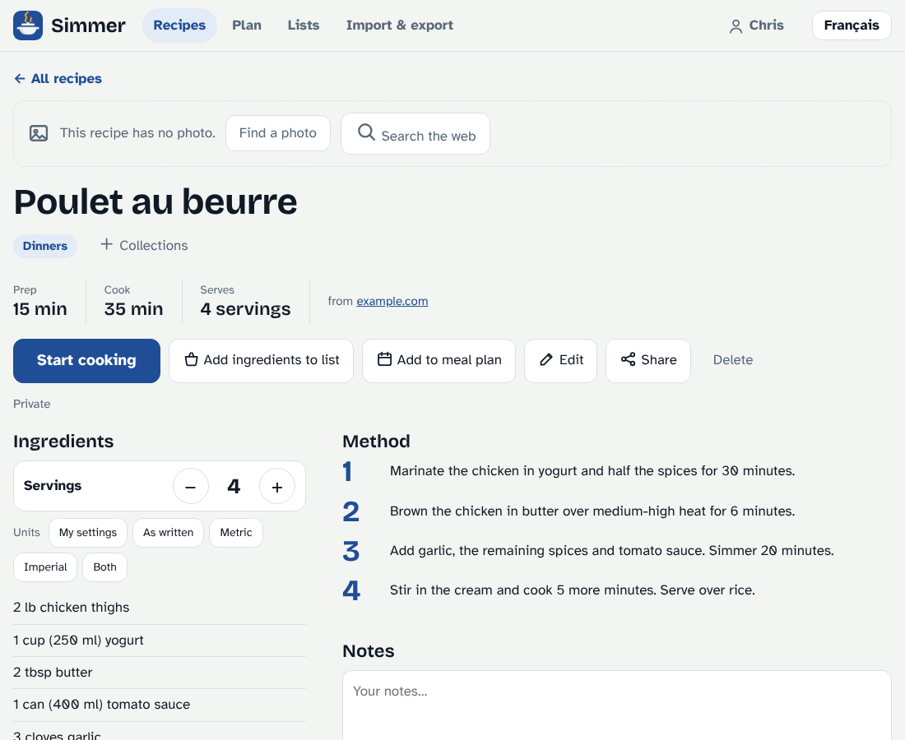
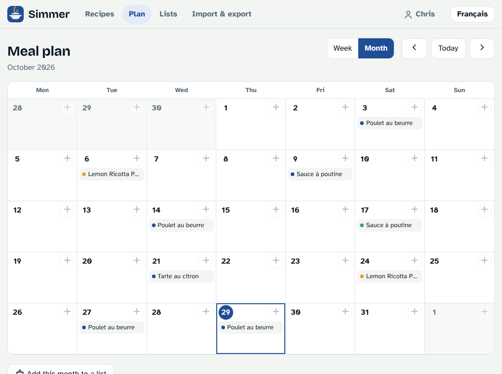
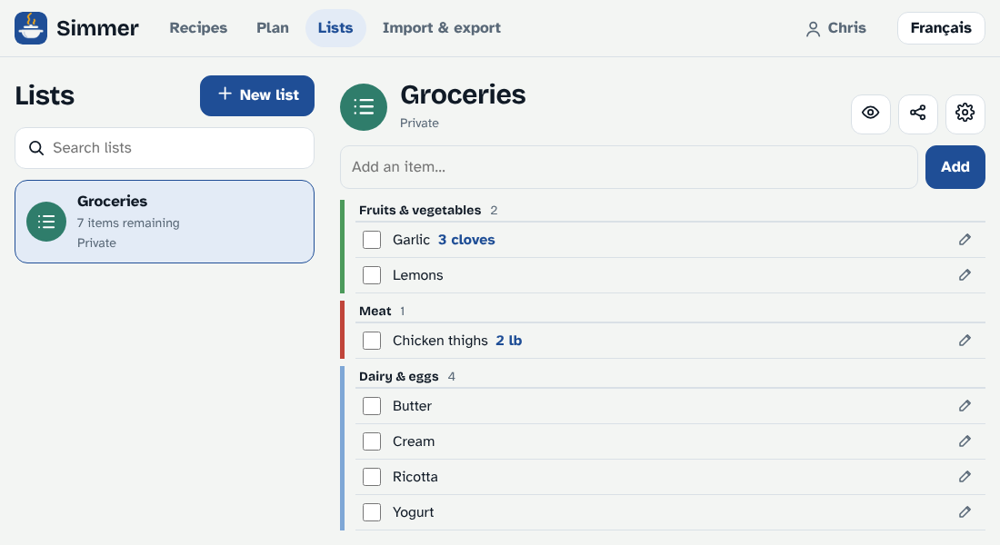
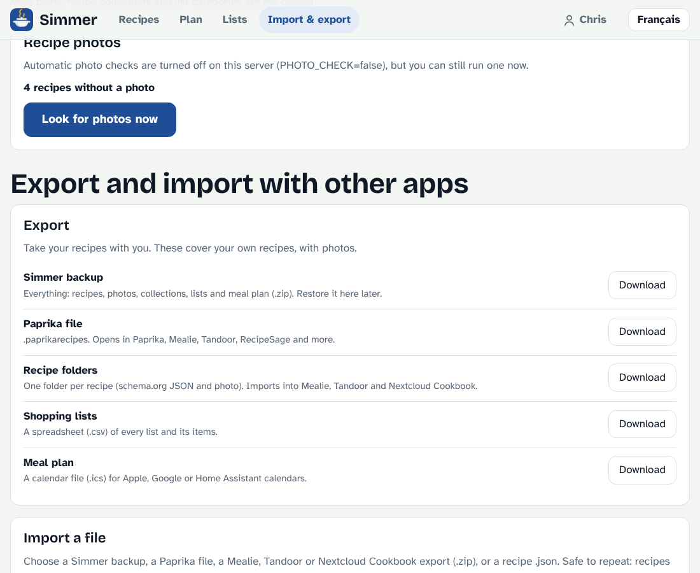
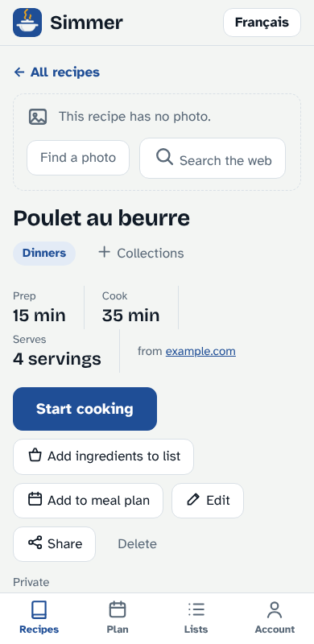

<p align="center"></p>

<h1 align="center">Simmer</h1>

<p align="center">Self-hosted recipes, shopping lists and meal plan for your family.<br>Paste a link, get a clean recipe, cook from it, shop for it. English and Quebec French.</p>

<p align="center"></p>

## What it does

- **Clean recipes from any link.** Standard recipe markup works with no API key; an optional `ANTHROPIC_API_KEY` reads pages without it. Write your own, or edit any recipe, with photos from your files or a web search.
- **Cook mode.** Full-screen steps with the screen kept awake, and times in a step become one-tap timers. Cook several recipes at once.
- **Scaling and units.** Scales bilingual quantities (`1 tasse (250 ml)`), and each person picks metric, imperial, both or as-written separately for weight, volume, length and temperature, including the numbers inside the steps.
- **Lists that know ingredients.** Items sort themselves into aisles, with your own store layouts, per-list categories and templates (groceries, hardware, IKEA, to-do, blank).
- **Meal plan.** Week or month calendar, shared per meal, with “add to a list” scaled to the servings you planned.
- **A household, or just you.** Invite family with a one-time link. Share recipes, lists and single meals with households or individual people.
- **Collections, search, ratings and notes** for a recipe box that stays easy to browse.
- **Installable.** Works as an app on Android and iPhone (PWA), and inside Home Assistant.
- **Home Assistant.** A HACS integration with the full app in the sidebar, to-do lists, a meal-plan calendar, sensors and services. See [docs/home-assistant.md](docs/home-assistant.md).
- **Import and export.** Bring recipes from AnyList, Mealie, Paprika or any schema.org source, and take everything out as a backup, Paprika, recipe folders, CSV or iCalendar. See [docs/import-export.md](docs/import-export.md).
- **Yours.** Plain JSON files in one folder, no database, no cloud account. Updates itself from this repo if you want.

<p align="center">
  
  
</p>
<p align="center">
  
  
</p>

## Quick start

### Unraid
No Docker Hub or GHCR needed: the image is built on your server from this repo.
1. In the Unraid web terminal (public repo):
   `curl -fsSL https://raw.githubusercontent.com/moimeme81/simmer/main/unraid/build.sh | sh`
   (For a private repo, `export GITHUB_TOKEN=<read token>` first; see the header of `unraid/build.sh`.)
2. Copy `unraid/simmer.xml` to `/boot/config/plugins/dockerMan/templates-user/my-simmer.xml`, then Docker tab → Add Container → Template: Simmer → Apply. (Or add it by hand: repository `simmer:local`, port 3000, path `/data` → `/mnt/user/appdata/simmer`, `PUID=99`, `PGID=100`.)
3. Open `http://SERVER-IP:3000` and create the first account. It becomes the admin; invite everyone else from **Account → Invite someone**.

### Docker Compose
```
docker compose up -d --build
```
Then open `http://localhost:3000`.

### Updating
Set `AUTO_UPDATE=true` (the Unraid template does) and Simmer checks this repo daily and updates itself, rolling back automatically if the new version fails to start. Updates that change dependencies are not applied automatically: rebuild the image (run the Unraid build command again, then Edit → Apply on the container). Your data in `/data` is never touched.

Then put it behind HTTPS: [docs/reverse-proxy.md](docs/reverse-proxy.md).

## Configuration

| Variable | Default | Purpose |
|---|---|---|
| `PORT` | 3000 | Listen port |
| `PUID` / `PGID` | 99 / 100 | Owner of files in `/data` |
| `TZ` | `UTC` | Timezone, so “today” matches yours (for example `America/Toronto`) |
| `ANTHROPIC_API_KEY` | – | Optional: AI extraction for pages without recipe markup |
| `LLM_MODEL` | claude-haiku-5-5 | Model for that fallback |
| `ALLOW_PRIVATE_URLS` | false | Let non-admins import from LAN addresses |
| `PHOTO_CHECK` | true | `false` stops the daily search for photos on recipes saved without one |
| `IMAGE_SEARCH_URL` | – | Use another Openverse-compatible service for web photo search |
| `AUTO_UPDATE` | false (true in the Unraid template) | Self-update from GitHub |
| `UPDATE_REPO` / `UPDATE_BRANCH` | `moimeme81/simmer` / `main` | Where updates come from |
| `UPDATE_INTERVAL_HOURS` | 24 | How often to check |
| `GITHUB_TOKEN` | – | Only for a private repo |

## Documentation

- [Features in detail](docs/features.md): lists, units, photos, collections, cooking, editing
- [Accounts, households and sharing](docs/accounts-and-sharing.md)
- [Import and export](docs/import-export.md): AnyList, Mealie, Paprika, backups
- [Home Assistant](docs/home-assistant.md): panel, entities, services, automations
- [Reverse proxy and HTTPS](docs/reverse-proxy.md)

## Development

```
npm install
npm test          # node tests (server, units, importers, launcher)
npm start         # http://localhost:3000, data in ./data with DATA_DIR=./data
```
The Home Assistant integration is tested against real Home Assistant code: `pip install pytest-homeassistant-custom-component`, then `pytest`.
The server is Node 22 + Express with a plain-script front end (no build step). Storage is JSON files.

## License

GPL-3.0-only. See [LICENSE](LICENSE).
